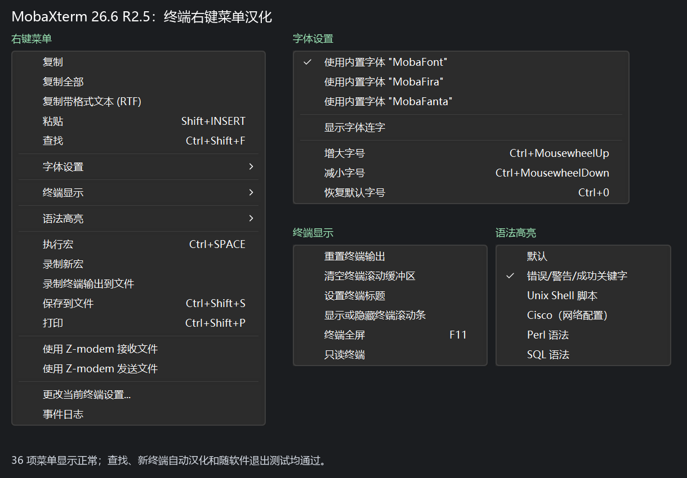

# MobaXterm 简体中文汉化

非官方 MobaXterm 简体中文汉化项目，覆盖主界面、设置、新建会话和终端右键菜单。每个官方版本对应一个 Release，同时提供**解压即用的汉化便携包**与**预编译图形化汉化工具**。

发行版本号跟随官方版本号，例如 **v26.5、v26.6**。两种方式均无需安装 Python 或自行编译。项目自编代码采用 [MIT](LICENSE)，MobaXterm 本体及组件适用各自上游许可。

## 下载与使用

运行环境：**Windows 10/11，64 位**。进入 [Releases](https://github.com/451909626/mobaxterm-zh-cn/releases)，选择需要的官方版本。

### 方式一：直接运行汉化便携包

以 v26.6 为例：

1. 下载 **`MobaXterm_Portable_v26.6_zh-CN.zip`**。
2. 解压到独立目录，双击 **`MobaXterm.exe`**。
3. 以后均从这个入口运行，以同时启用界面中文与终端右键菜单中文。

便携包沿用官方三个文件的名称及根目录结构，另附启动器和说明：

```text
MobaXterm_Personal_26.6.exe
CygUtils.plugin
CygUtils64.plugin
MobaXterm.exe
汉化说明.txt
汉化工具-MIT-LICENSE.txt
上游许可说明.txt
组件许可说明.txt
```

主程序已汉化，两个 CygUtils 组件保持对应官方原始字节。压缩包不携带用户配置、会话、凭据或日志，首次运行会创建本地配置。

### 方式二：使用预编译汉化工具

适合希望从自己下载的官方原包生成汉化副本的用户：

1. 下载同一 Release 的 **`MobaXterm_Chinese_Tool_v26.6_win-x64.zip`**，解压后双击 **`MobaXterm汉化工具.exe`**。
2. 从 [MobaXterm 官网](https://mobaxterm.mobatek.net/download-home-edition.html)取得对应版本的 **Home 便携版 ZIP**，无需解压。
3. 在工具中选择原包，指定新的输出文件夹，点击 **“开始汉化”**。
4. 完成后打开输出目录，双击 **`MobaXterm.exe`**。

工具核对版本和原包摘要，不改写原始 ZIP，不覆盖已有目录。输出采用新配置，旧会话需另行迁移。

### 每个 Release 的附件

| 附件示例 | 用途 |
|---|---|
| `MobaXterm_Portable_v26.6_zh-CN.zip` | 已汉化便携包，解压即可运行 |
| `MobaXterm_Chinese_Tool_v26.6_win-x64.zip` | 预编译图形化工具，可自行汉化官方原包 |
| `SHA256SUMS.txt` | 上述两个 ZIP 的 SHA-256 |

图形化工具 ZIP 只包含工具、翻译数据、运行环境和许可；汉化便携 ZIP 包含非官方修改后的客户端。GitHub 自动提供的 `Source code` 是开发者源码。

## 版本支持与验证

| 对应官方构建 | Release | 进度 |
|---|---|---|
| 26.5.0.5542 Home Portable | [v26.5](https://github.com/451909626/mobaxterm-zh-cn/releases/tag/v26.5) | 构建和静态校验通过；完整实屏回归待补，作为预发布版本 |
| 26.6.0.5560 Home Portable | [v26.6](https://github.com/451909626/mobaxterm-zh-cn/releases/tag/v26.6) | 汉化主程序重建结果与此前实屏检查版本一致 |

最低目标版本为 26.5，完整界面逐版本适配。尚未登记的版本会停止处理；不能把旧版二进制补丁直接用于任意新版。安装版、Professional 版、其他 Windows 系统代码页不在当前已验证范围内。详见[版本适配说明](docs/COMPATIBILITY.md)与[验证记录](docs/VALIDATION.md)。

## 汉化范围

- 主窗口：顶部按钮、菜单、提示、状态栏、首页和默认会话目录等。
- 设置窗口：常用设置页及相关高级窗口。
- 新建会话：常用连接类型与设置项。
- 终端右键菜单：主菜单和字体设置、终端显示、语法高亮三个子菜单，共 36 项。

26.5 涉及 45 个窗体、1608 处资源文字和 18 处指定显示文字；26.6 为 45 个窗体、1613 处资源文字和 18 处指定显示文字。用户会话名称、主机、账号、命令、路径和远程终端输出保持原样。



日常使用 **`MobaXterm.exe`**。直接打开主 EXE 可以显示界面中文，但不会自动启用独立启动器提供的终端菜单中文。已有配置的副本迁移见[构建与迁移说明](docs/BUILD.md)。

## 开发与发布

Git 仓库保存源码和翻译补丁，二进制成品通过 Release 附件发布。`.gitignore` 基于 VisualStudio 模板，并排除官方输入、配置、日志、缓存与构建产物。

维护者需要 Windows、64 位 Python、.NET Framework C# 编译器；普通用户无需这些开发工具。

```powershell
python -m pip install -r requirements-build.txt
python -m unittest discover -s tests -v
python scripts/build_release.py --tag v26.6 --source-zip "D:\Downloads\MobaXterm_Portable_v26.6.zip" --output dist/v26.6
```

省略 `--source-zip` 时，从清单中的官方地址下载并校验原包。构建先封装图形化工具，再使用封装后的工具生成汉化便携包，检查每个程序文件的摘要及附件内容，生成 `SHA256SUMS.txt`。

推送 `v26.5`、`v26.6` 等官方版本标签后，GitHub Actions 自动测试、构建并发布上述两类 ZIP 和校验文件。同一版本需要修订时，先备份并验证原附件，再显式替换并更新发布说明。内部仍记录完整官方构建号及工具构建信息，Release 的公开版本号跟随官方。详见[发布流程](docs/RELEASES.md)。

## 项目结构

```text
.github/workflows/         源码检查与双包发布
launcher/                  中文菜单启动器源码
src/mobaxterm_zh/           图形界面、校验、汉化、下载与发布审计
scripts/                   构建、发布与检查入口
patches/<完整版本>/        各版本翻译目标、位置和摘要
translations/              终端菜单对照
legal/                     工具所用依赖的许可文本
tests/                     格式、版本、保护范围与发布测试
docs/                      使用、开发、发布与验证说明
```

## 许可与项目关系

本项目与 Mobatek 没有隶属关系。自编代码与有权授权的翻译贡献采用 [MIT](LICENSE)，不重新许可 MobaXterm 本体、名称、商标或第三方组件。

汉化便携包为非官方修改版，原厂数字签名已失效并移除，不代表 Mobatek 官方发行。上游软件的修改与分发仍受 [Mobatek 官方许可](https://mobaxterm.mobatek.net/license.html)约束，MIT 不替代上游许可，也不表示已取得额外授权。见[上游许可说明](docs/UPSTREAM_LICENSE.md)与 [THIRD_PARTY_NOTICES.md](THIRD_PARTY_NOTICES.md)。
